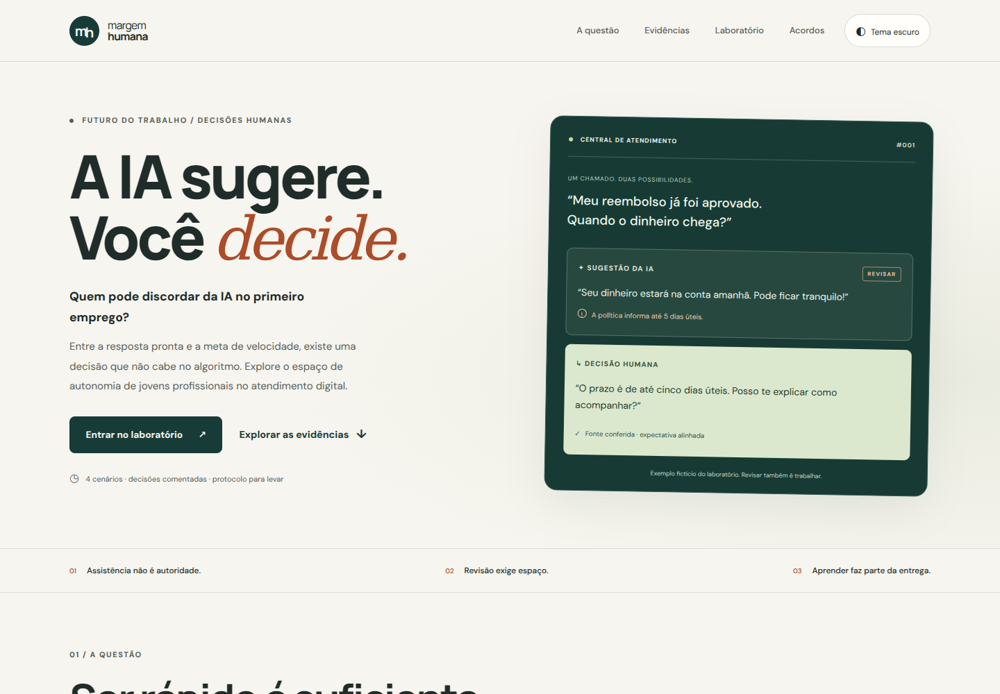

# Margem Humana
## Quem pode discordar da IA no primeiro emprego?

### Visão Geral e Preview

Site sobre autonomia, empatia e aprendizagem de jovens atendentes diante de sugestões de IA e metas de velocidade. O visitante analisa quatro situações fictícias e exporta um protocolo de revisão. Os gráficos distinguem evidências de produtividade de expectativas geracionais.

**Situação atual (03/11/2026):** [repositório público](https://github.com/henriquepedro500/Margem-Humana) e [site no GitHub Pages](https://henriquepedro500.github.io/Margem-Humana/) acessíveis. A dupla informou que realizou os testes manuais; os procedimentos, resultados e evidências devem constar em [REGISTRO_DA_DUPLA.md](REGISTRO_DA_DUPLA.md).

### Integrantes, repositório e site publicado

| Campo da entrega | Informação |
|---|---|
| Estudante 1 | **Pedro Henrique Teixeira De Lima** — GitHub: **@henriquepedro500** |
| Estudante 2 | **João Pedro De Souza** — GitHub: **@joaoopedro2007** |
| Repositório público | [https://github.com/henriquepedro500/Margem-Humana](https://github.com/henriquepedro500/Margem-Humana) |
| GitHub Pages | [https://henriquepedro500.github.io/Margem-Humana/](https://henriquepedro500.github.io/Margem-Humana/) |
| Conferência da publicação | Site público acessível em 03/11/2026; resultados dos testes manuais: [REGISTRO_DA_DUPLA.md](REGISTRO_DA_DUPLA.md) |

As atividades da dupla estão documentadas em [REGISTRO_DA_DUPLA.md](REGISTRO_DA_DUPLA.md) para registrar, com evidência, o trabalho de cada integrante, testes manuais e correções efetuadas.

**Transparência sobre IA e autoria:** a implementação fornecida nesta versão foi produzida e revisada com assistência de IA, inclusive HTML e CSS. Caso o enunciado exija autoria manual nessas etapas, ainda é indispensável o trabalho efetivo e documentado dos integrantes. As três fichas do [AUDITORIA_IA.md](AUDITORIA_IA.md) distinguem especificações reconstruídas de mensagens literalmente enviadas. Não são atribuídas revisões, commits ou testes manuais aos estudantes sem evidência.

### Abrir e executar

Extrair o ZIP inteiro e abrir `index.html` no navegador. Nenhuma instalação é necessária. Bootstrap, Chart.js e fontes têm cópias locais; a aplicação funciona sem internet depois de extraída. Os links de pesquisa e as tentativas de carregar CDNs precisam de rede.

Para editar: modificar HTML/CSS diretamente. Ao alterar arquivos JS modulares, executar `node build.mjs`; o HTML usa `app.bundle.js` para permitir abertura por file://. Servidor local opcional: `python -m http.server 8000`.

### Estrutura de arquivos (compatível com o repositório publicado)

**Atenção:** o envio inicial pelo navegador colocou todos os arquivos na **raiz do repositório**, sem subdivisões `js/`, `css/`, `docs/` ou `tests/`. Esta atualização mantém o mesmo formato plano **para preservar os caminhos que já funcionam no site publicado**. Não misture os dois layouts.

| Arquivos na raiz | Função |
|---|---|
| `index.html` | HTML5 semântico; importa CSS, Bootstrap via CDN e `app.bundle.js` |
| `styles.css`, `advanced.css`, `fonts.css` | Design responsivo, efeitos e fontes locais |
| `app.js`, `dom.js`, `scenarios.js`, `simulator.js`, `data.js`, `chart.js`, `theme.js` | Códigos-fonte JavaScript modulares |
| `app.bundle.js` | JS clássico executado pelo site; recompilado com `npm run build` |
| `bootstrap.min.css`, `bootstrap-fallback.js`, `chart-fallback.js` | Cópias locais de contingência |
| `*.woff2`, `*-LICENSE.txt` | Fontes locais e licenças de dependências |
| `favicon.svg`, `preview.png` | Ícone e imagem de apresentação |
| `auditoria-v1-simulator.js`, `auditoria-v1-chart.js`, `auditoria-v1-theme.js` | Três versões iniciais preservadas para comparar com as revisões finais |
| `AUDITORIA_IA.md`, `PESQUISA.md`, `REGISTRO_DA_DUPLA.md`, `INTEGRACAO.md`, `LEVANTAMENTO_FALHAS.md` | Auditoria, referências, checklist e registros de revisão humana |
| `core.test.js`, `ui.test.cjs`, `build.mjs`, `package.json` | Testes e rotina de build |
| `.gitignore`, `.nojekyll`, `LICENSE` | Arquivos de configuração e licença |

### Arquitetura de Software e Contratos de Dados

Frontend estático, sem backend, frameworks de aplicação ou API de IA. Bootstrap 5 fornece componentes básicos; JavaScript Vanilla controla os recursos avançados. Não há chaves secretas, cadastro ou envio das escolhas a servidor.

O app monta três pontos: `theme-toggle`, `simulator-root`, `chart-root`. O menu e o accordion usam Bootstrap; se seu JS faltar, controles mínimos locais preservam a navegação. O gráfico destrói a instância anterior ao trocar indicador/tema; a tabela continua disponível se não houver canvas funcional.

| Contrato | Esquema |
|---|---|
| Scenario | `{id, title, context, suggestion, options: Option[3]}` |
| Option | `{id, label, points: 0\|1\|2, feedback, action}` |
| Answers | Array de quatro IDs válidos, na ordem dos cenários |
| Result | `{points: integer, maximum: 8, title, actions: string[4], notice}` |
| Dataset | `{title, unit, labels: string[], values: number[], population, source, url, note}` |
| Tema | `light` ou `dark`, chave `margem-humana-theme` no localStorage |

`evaluate` rejeita entradas inválidas e soma quatro decisões. A pontuação é didática, sem interpretação clínica. `buildProtocol` produz texto UTF-8. `getDataset` valida a chave e devolve cópia isolada. As chaves de dataset são produtividade, proposito e impacto. Labels e values têm o mesmo comprimento; todos os dados indicam fonte, população e unidade.

Só o tema é persistido. Escolhas ficam em memória e são apagadas ao recarregar/reiniciar. Texto dinâmico usa textContent. O download usa Blob local e revoga sua URL. O estado acessível e o foco acompanham a interação. A análise do simulador é O(n) no número de cenários, com três opções por cenário.

### Declaração de Dependências e CDN

| Dependência | Versão | Uso |
|---|---|---|
| Bootstrap | 5.3.8 | Grid, navbar, cards, accordion, badges; sem jQuery |
| Chart.js | 4.4.8 UMD | Barras interativas, tooltip e atualização |
| Google Fonts | Manrope e DM Sans, pesos declarados no HTML | Tipografia; cópias WOFF2 locais |
| Node.js | 20+ | Somente desenvolvimento/testes |
| jsdom | 26.0.0, devDependency | Testes de DOM; não é navegador visual |
| css-tree | 3.1.0, devDependency | Validação sintática de CSS |

CDNs: `https://cdn.jsdelivr.net/npm/bootstrap@5.3.8/dist/css/bootstrap.min.css`, `https://cdn.jsdelivr.net/npm/bootstrap@5.3.8/dist/js/bootstrap.bundle.min.js`, `https://cdn.jsdelivr.net/npm/chart.js@4.4.8/dist/chart.umd.min.js` e `https://fonts.googleapis.com/`.

Bootstrap usa SRI específico da versão. A cópia local de CSS antecede a CDN; os fallbacks JS só executam a biblioteca se ela ainda não existir, evitando registros duplicados. As fontes locais têm font-display: swap. As cópias locais e as licenças estão na raiz do repositório.

Compatibilidade pretendida: Chrome, Firefox, Safari e Edge modernos. Há tratamento de localStorage indisponível, redução de movimento e falha do gráfico. Consultar REGISTRO_DA_DUPLA.md para os testes manuais informados; não confundir intenção de compatibilidade com testes completos em todos os navegadores.

### Matriz de Rastreabilidade e Colaboração

| Requisito | Implementação | Contribuição verificável da dupla |
|---|---|---|
| Recorte e fontes | PESQUISA.md; QJE e Deloitte | Fontes identificadas; verificar registro da revisão crítica |
| HTML/Bootstrap | index.html | Gerado por IA; não atribuir autoria manual |
| Design/responsividade | styles.css | Gerado com apoio de IA; testes manuais relatados pela dupla |
| Simulador | scenarios.js e simulator.js | Revisão manual relatada por Pedro; evidências em REGISTRO_DA_DUPLA.md |
| Dados/gráfico | data.js e chart.js | Revisão manual relatada por João; fontes em PESQUISA.md |
| Tema/acessibilidade | theme.js, styles.css | Revisão relatada pela dupla; detalhes no registro |
| Auditoria | AUDITORIA_IA.md e auditoria-v1-*.js | 3 fichas e versões iniciais preservadas; revisões relatadas |
| Publicação | GitHub Pages e REGISTRO_DA_DUPLA.md | Site público acessível; conferir logs dos testes manuais da dupla |

A participação humana deve ser documentada em [REGISTRO_DA_DUPLA.md](REGISTRO_DA_DUPLA.md), sem atribuir à dupla código gerado por IA. Há commits públicos atribuídos aos dois integrantes: [Pedro](https://github.com/henriquepedro500/Margem-Humana/commit/a3ae0a62b52ef8ec1e224b488f722745d2d746a7) e [João](https://github.com/henriquepedro500/Margem-Humana/commit/618a448a0fb835c015831fe1ff887f74f8ed6943). Esses commits comprovam edições na documentação, não a execução de todos os testes. As evidências manuais e correções eventualmente feitas devem permanecer identificadas separadamente.

### Checklist de submissão

O projeto reúne tema delimitado, HTML semântico, CSS com `:root`, Bootstrap 5 por CDN e fallback local, simulador, gráficos e três fichas de auditoria. O repositório contém commits dos dois integrantes e o GitHub Pages está publicado. **A conclusão acadêmica depende da autenticidade das revisões humanas, dos resultados registrados e das exigências específicas do professor.** Consultar [REGISTRO_DA_DUPLA.md](REGISTRO_DA_DUPLA.md), que documenta os testes declarados pela dupla.

**GitHub Pages:** [abrir o site publicado](https://henriquepedro500.github.io/Margem-Humana/). O `index.html` e seus recursos estão na raiz da branch `main`. A dupla informou ter testado o site; os resultados específicos devem ser mantidos em `REGISTRO_DA_DUPLA.md`. Ao modificar os módulos JavaScript no futuro, rodar `npm run build` e enviar também o `app.bundle.js` gerado.

### Referências

Referências completas e limites: [PESQUISA.md](PESQUISA.md).

- Brynjolfsson, Li e Raymond (2025), *Generative AI at Work*: https://doi.org/10.1093/qje/qjae044
- Deloitte (2025): https://www.deloitte.com/global/en/about/press-room/deloitte-2025-gen-z-and-millennial-survey.html
- Bootstrap: https://getbootstrap.com/docs/5.3/getting-started/introduction/
- Chart.js: https://www.chartjs.org/docs/latest/getting-started/integration.html
- GitHub Pages: https://docs.github.com/en/pages/getting-started-with-github-pages/configuring-a-publishing-source-for-your-github-pages-site

### Testes e licença

`npm test`: quatro testes de lógica sem dependências externas. `npm install` e `npm run test:ui`: testes de DOM e CSS (dependências de desenvolvimento). `npm run build`: atualizar o bundle. O arquivo [REGISTRO_DA_DUPLA.md](REGISTRO_DA_DUPLA.md) documenta as revisões e os testes manuais declarados; o README não substitui os registros de Console/Network do site público.

Código do projeto sob MIT. Bootstrap e Chart.js mantêm suas licenças; fontes mantêm a SIL Open Font License. Estudos e documentos externos permanecem sob seus próprios termos.
